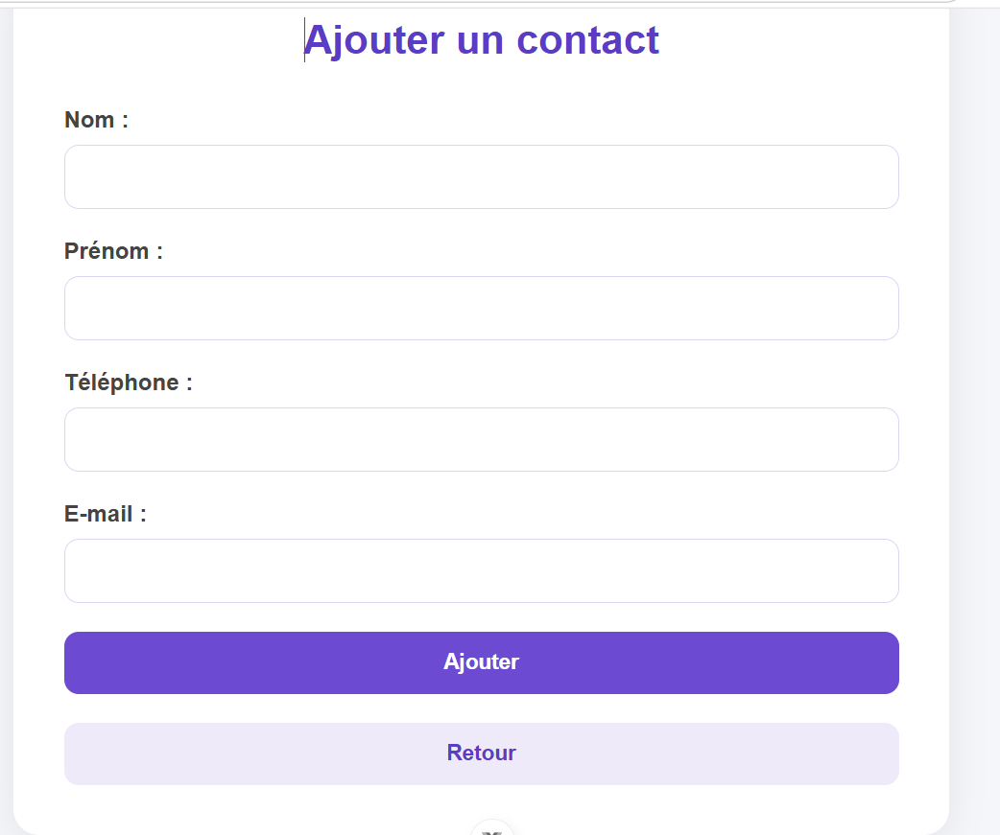
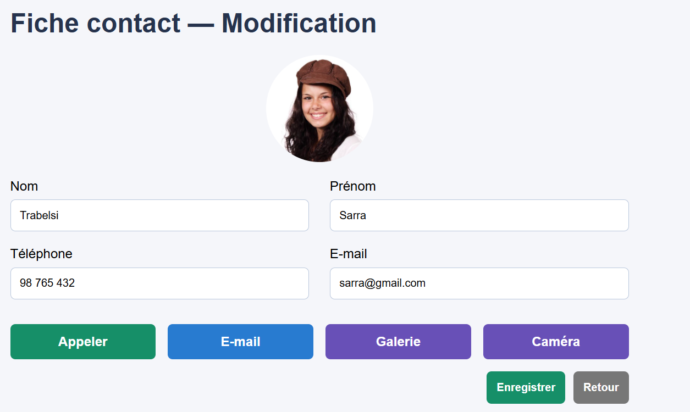

# Vue Contact

## Description

**Vue Contact** est une application web de gestion des contacts développée avec **Vue.js 3** et **Vite**.

Elle permet de gérer facilement les contacts à travers une interface simple et intuitive.

## Fonctionnalités

- Afficher la liste des contacts.
- Ajouter un nouveau contact.
- Consulter les détails d'un contact.
- Modifier les informations d'un contact.
- Modifier la photo d'un contact depuis la galerie ou la caméra.
- Vérifier les informations saisies dans le formulaire :
  - Nom et prénom obligatoires.
  - Numéro de téléphone composé de 8 chiffres.
  - Adresse e-mail valide.

## Technologies utilisées

- Vue.js 3
- JavaScript
- Vue Router
- HTML5
- CSS3
- Vite

## Captures d'écran

### 1. Liste des contacts


### 2. Ajouter un contact



### 3. Détails d'un contact


### 4. Modifier un contact



## Installation et lancement

### 1. Cloner le projet

```bash
git clone URL_DU_REPOSITORY
```

### 2. Accéder au dossier du projet

```bash
cd vue-contact
```

### 3. Installer les dépendances

```bash
npm install
```

### 4. Lancer le serveur

```bash
npm run dev
```

L'application sera accessible à l'adresse indiquée dans le terminal, généralement `http://localhost:5173/`.

## Structure du projet

```text
vue-contact/
│
├── captures/
│   ├── liste-contacts.png
│   ├── ajouter-contact.png
│   ├── detail-contact.png
│   └── modifier-contact.png
│
├── src/
│   ├── data/
│   │   ├── images/
│   │   └── contacts.js
│   ├── router/
│   │   └── index.js
│   ├── views/
│   │   ├── ListeContacts.vue
│   │   ├── AjouterContact.vue
│   │   └── DetailContact.vue
│   ├── App.vue
│   └── main.js
│
├── index.html
├── package.json
└── README.md
```

## Remarque

Les données des contacts sont stockées temporairement en mémoire. Elles ne sont pas enregistrées dans une base de données.

## Auteur

Projet réalisé dans le cadre de l'apprentissage de Vue.js.